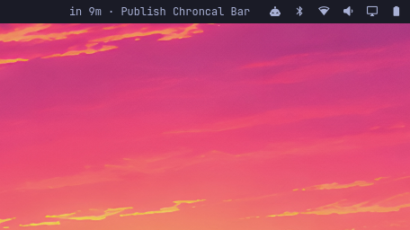

# Chroncal Bar

An [Omarchy Quattro](https://omarchy.org/) menu-bar calendar powered by [Chroncal](https://github.com/DouglasdeMoura/chroncal).



## Features

### Bar

- Shows the meeting in progress (every overlapping one), or the next upcoming meeting, with a calendar-colored square.
- Hands over to the next meeting once it is inside the countdown window, even while another is still running.
- Prefers timed meetings over all-day events; all-day events show when nothing timed is left today (`All day · …`, `Sun · …`).
- Never shows declined invitations.
- Uses relative labels near an event (`in 5m`, `12m left`) and explicit weekday labels for later events (`Mon 09:00`). Countdowns tick on a live clock between agenda refreshes.
- Can limit itself to events starting within a number of hours (bar horizon).
- Hides itself when no visible event remains in the configured preview window.
- Hovering shows nothing. Left click opens the agenda, middle click joins the ongoing or next video meeting, and right click refreshes.

### Agenda panel

- Groups events under Today, Tomorrow, and later dates, each with its date; Today always shows, with "No more events today" once the day is clear.
- Treats all-day events as calendar dates in your local zone, and lists multi-day events that are still running under Today.
- Shows live status on each row (`in 25m`, `12m left`) and a one-click Join button on video meetings that are on or start within the hour.
- Marks unanswered invitations (hollow stripe, "Invited") and shows declined events dimmed and struck through.
- Detects Google Meet, Zoom, Teams, Webex, Jitsi, Whereby, Chime, GoTo, Around, Slack, and Discord links in the conference field, URL, location, or notes, and labels the button by provider (`Join Google Meet`).
- Hides the Google Meet and Microsoft Teams dial-in boilerplate from notes; the Join button carries that link.
- Shows guest counts (`8 guests · 5 yes · 1 no · 2 awaiting`), the organizer, and guests sorted by response.
- Filters hidden calendars and supports per-calendar inclusion.
- Searches titles, descriptions, locations, calendar names, and participants.
- Shows the event date, location, notes, conferencing links, attendees, RSVP state, and who organized the event.
- Turns http(s) URLs in notes into clickable links colored with the Omarchy theme accent.
- Opens Google Meet links as the calendar owner account (`authuser`).
- Wraps long titles instead of cropping them.
- Opens maps from an open-link icon at the end of the location name.
- Shows Join and Copy link on the left when the event has a link, Edit and Delete on the right, and copy/RSVP confirmations beside Join.
- Hides Edit, Delete, and RSVP on read-only subscriptions (for example holiday calendars).
- Optionally shows Open in Chroncal at the end of event details (`chroncal --event`); off by default, with `g` still available.
- Copies complete event details to the clipboard with `p`.
- Creates, edits, and deletes Chroncal events without shell interpolation, with a calendar picker limited to writable calendars.
- Lets you change the time of events pinned to your local timezone (most synced Google events); events pinned to another zone keep their time.
- Preserves omitted fields during edits and never reinterprets unchanged event times.
- Confirms deletion before changing Chroncal data.
- Shows an enabled edit pencil for every event with a usable identity.
- Loads and edits the whole recurring series for generated occurrences.
- Edits stored recurrence overrides as that override only.
- Creates and edits recurrence with Chroncal Repeat presets and inline Custom fields.
- Leaves stored override Repeat rules on the series; open the series editor to change them.
- Deletes this event, this and following, or all events in a recurring series from the panel confirm.
- Replies Yes, Maybe, or No from a Going control on event details when the calendar owner is an invited attendee.

### Meeting alerts

- Optional notification a set number of minutes before each timed, non-declined meeting, with a Join action that opens the call. Off by default because Chroncal's own alarm service may already remind you.

This is menu-bar parity, not a replacement for Chroncal's full TUI. Timezone-sensitive time changes, alarms, availability, sync configuration, account management, and advanced calendar operations remain in Chroncal.

## Requirements

- Omarchy Quattro
- Chroncal 0.7.4 or newer on `PATH`
- A Chroncal build that includes `chroncal event rsvp` for Yes/No/Maybe replies (not in 0.7.4)
- A Chroncal build that includes `chroncal --event` to open the TUI on the selected event
- `bash`, `jq`, GNU `date`, and GNU `timeout`
- `xdg-open` for links and maps
- `wl-copy` for copy actions
- `notify-send` for helper errors

Install Chroncal with mise if needed:

```sh
mise use -g github:DouglasdeMoura/chroncal@0.7.4
```

That pin is enough for the rest of the bar. Yes/No/Maybe needs a Chroncal newer than 0.7.4, or a local build of `feat/event-rsvp-cli`.

Authenticate and configure calendars in the Chroncal TUI before expecting events on the bar:

```sh
chroncal
```

## Install

```sh
omarchy plugin add https://github.com/DouglasdeMoura/chroncal-bar.git --enable
omarchy bar move douglasdemoura.chroncal-bar --section right --after omarchy.tray
```

The second command is optional. It places the widget beside the tray in the right-aligned bar group.

## Use

| Key | Context | Action |
| --- | --- | --- |
| `↑` / `↓`, `j` / `k` | Agenda | Move selection |
| `←` / `→`, `h` / `l` | Agenda | Previous or next day |
| `t` | Agenda | Jump to today's first event |
| `Enter` / `Space` | Agenda | Open selected event |
| `o` | Agenda | Join the selected meeting |
| `/` | Agenda | Open search |
| `c` | Agenda or details | Create event |
| `e` | Agenda or details | Edit event or recurring series |
| `x` or `Delete` | Agenda or details | Delete this event, this and following, or all events |
| `v` | Event details | Join or open event URL |
| `u` | Event details | Copy meeting link |
| `p` | Event details | Copy event details |
| `g` | Event details | Open this event in Chroncal |
| `y` / `n` / `m` | Event details | RSVP yes, no, or maybe |
| `s` | Agenda | Refresh |
| `C` or `,` | Agenda | Open settings |
| `?` | Agenda | Open shortcut help |
| `Ctrl+S` | Event editor | Save event or series |
| `Esc` or `q` | Any panel view | Back, cancel, or close |

Join the ongoing or next meeting from anywhere with the `join` IPC call, for example from a Hyprland binding in `~/.config/hypr/bindings.conf`:

```ini
bindd = SUPER CTRL, J, Join next meeting, exec, omarchy-shell douglasdemoura.chroncal-bar join
```

Search opens with `/`. Subviews share one header back arrow. Settings, shortcut help, and Create are the agenda header actions. Refresh happens when the panel opens, on `s`, and on bar right-click. Event-detail buttons cover the rest.

## Configure

Open the agenda and press `C` or `,`, or click the settings cog in the header. Available settings:

- Days ahead (1–30) and refresh interval.
- Maximum bar-title length, the relative-countdown window, and the bar horizon (only show events starting within N hours; 0 shows any).
- Included calendars; all are selected automatically until you customize the selection.
- Show or hide time and title in the bar.
- Include or exclude all-day events.
- Include or exclude events without participants.
- Include or exclude events without a physical location or meeting link.
- Include or exclude declined events in the agenda (they never show on the bar).
- Meeting alerts with a Join action, and how many minutes before start they fire.
- Show or hide the Open in Chroncal button on event details (off by default).

Calendar selection has two states. Default mode selects every current calendar and automatically includes calendars added later. The first checkbox change stores an exact custom selection; selecting none hides every event. Use **Use default (all calendars)** to discard the custom selection and return to automatic default mode.

Settings persist on the widget entry in `~/.config/omarchy/shell.json`. They can also be changed from the command line:

```sh
omarchy bar set douglasdemoura.chroncal-bar interval 60
omarchy bar set douglasdemoura.chroncal-bar lookaheadDays 7
omarchy bar set douglasdemoura.chroncal-bar showTitle On
omarchy bar set douglasdemoura.chroncal-bar showOpenInChroncal On
omarchy bar set douglasdemoura.chroncal-bar relativeLeadMinutes 10
omarchy bar set douglasdemoura.chroncal-bar barHorizonHours 12
omarchy bar set douglasdemoura.chroncal-bar joinReminderMinutes 1   # -1 turns alerts off
```

Force a refresh:

```sh
omarchy-shell douglasdemoura.chroncal-bar refresh
```

## Runtime and service behavior

The plugin runs inside Omarchy's long-running Quickshell process with your user permissions. Its QML timer starts a one-shot agenda helper at the configured interval; the helper emits one normalized JSON document and exits. The plugin does not start another Quickshell process, install packages, request elevated privileges, or run a remote installer.

Chroncal remains the source of truth. The plugin calls its CLI to read calendar and event data and to perform explicitly requested create, update, and delete actions. Helpers also read `~/.local/state/chroncal/state.json` for hidden calendar IDs.

Chroncal's optional `chroncal service run` process is separate. This plugin neither installs nor controls that service.

## Remove

```sh
omarchy plugin remove douglasdemoura.chroncal-bar
```

Removal deletes only the plugin. It does not remove Chroncal, calendar state, or any separate Chroncal service.

## Development

```sh
TZ=UTC bun tests/test-model.js
TZ=America/Sao_Paulo bun tests/test-model-local.js
tests/test-agenda.sh
tests/test-read-regular.sh
bash -n scripts/*
omarchy plugin validate .
/usr/lib/qt6/bin/qmllint -I /usr/share/omarchy/shell \
  BarWidget.qml Panel.qml components/*.qml
```

`qmllint` exits successfully but reports unresolved `qs.Commons` and `qs.Ui` types outside the running Omarchy shell. Runtime smoke tests cover the real plugin host.

## License

[MIT](LICENSE)
